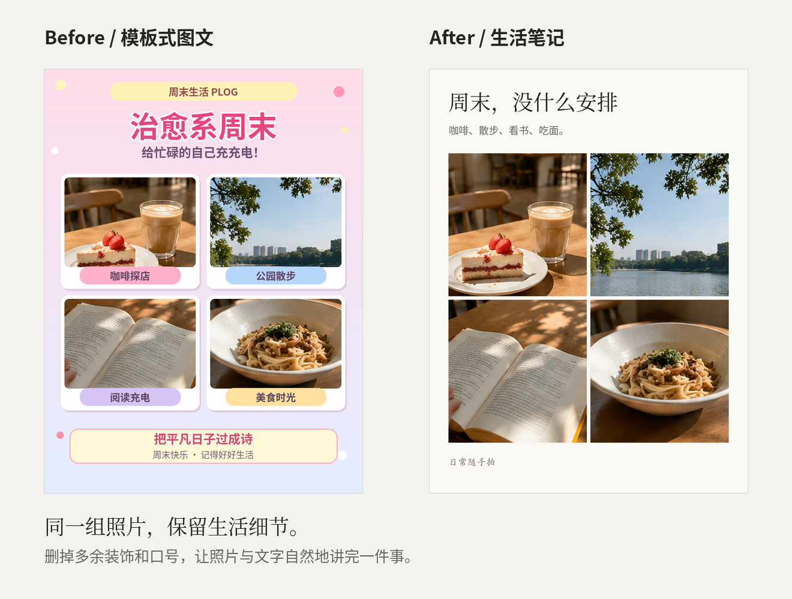
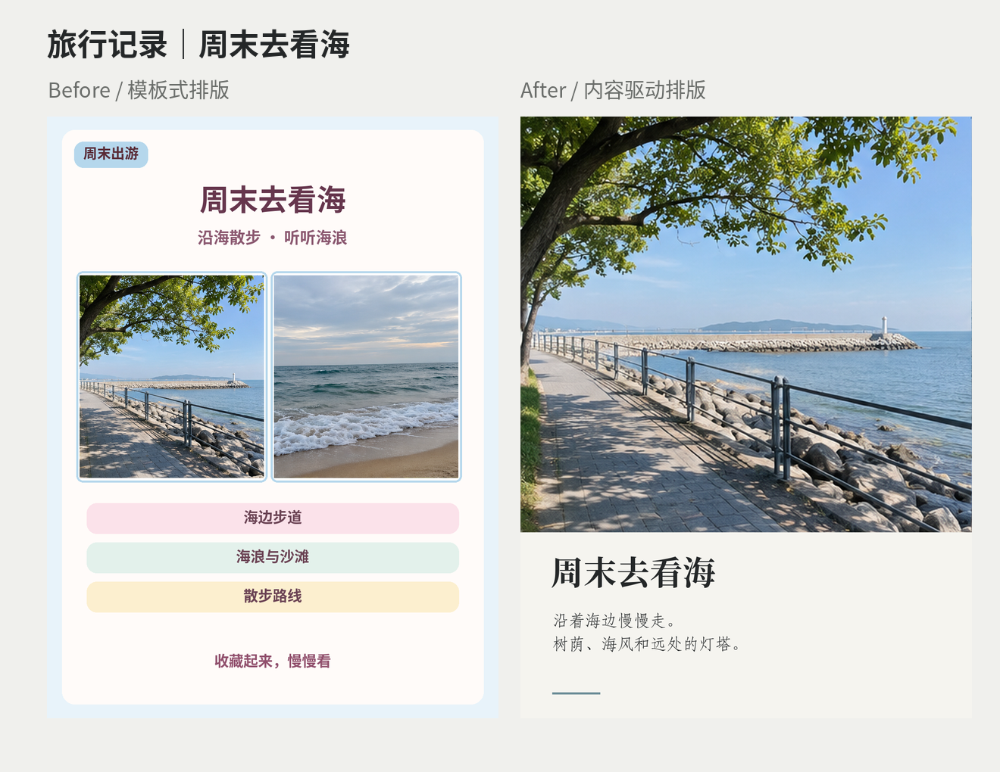
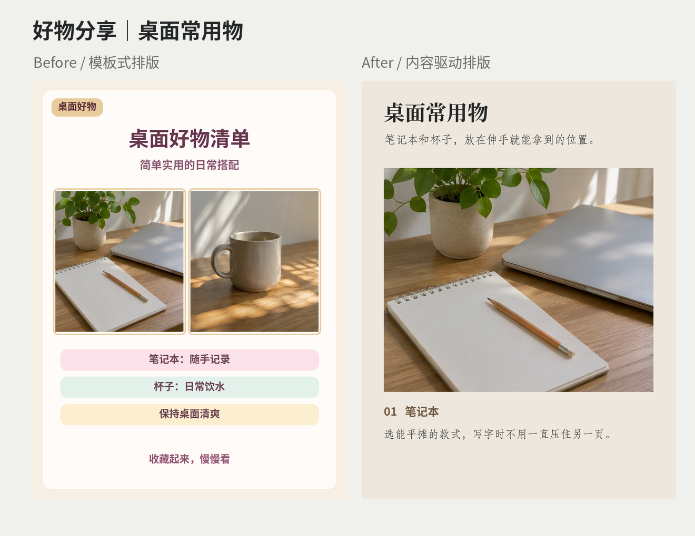
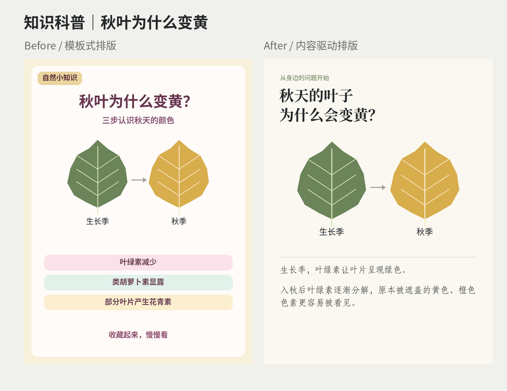
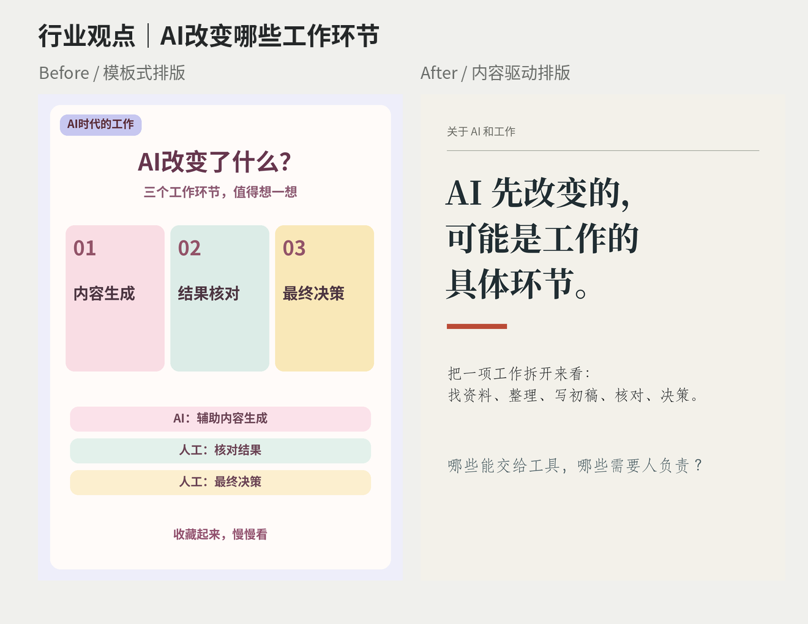
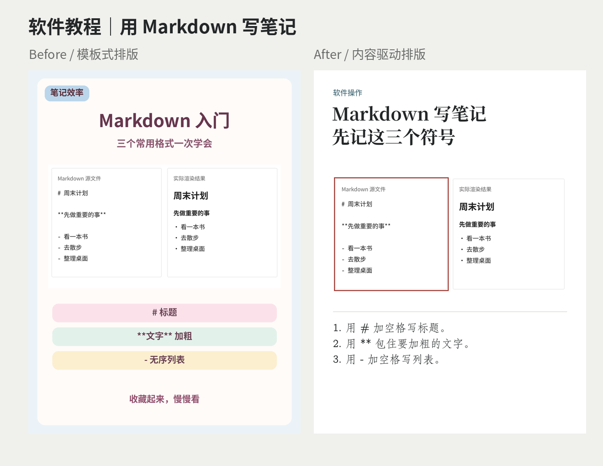
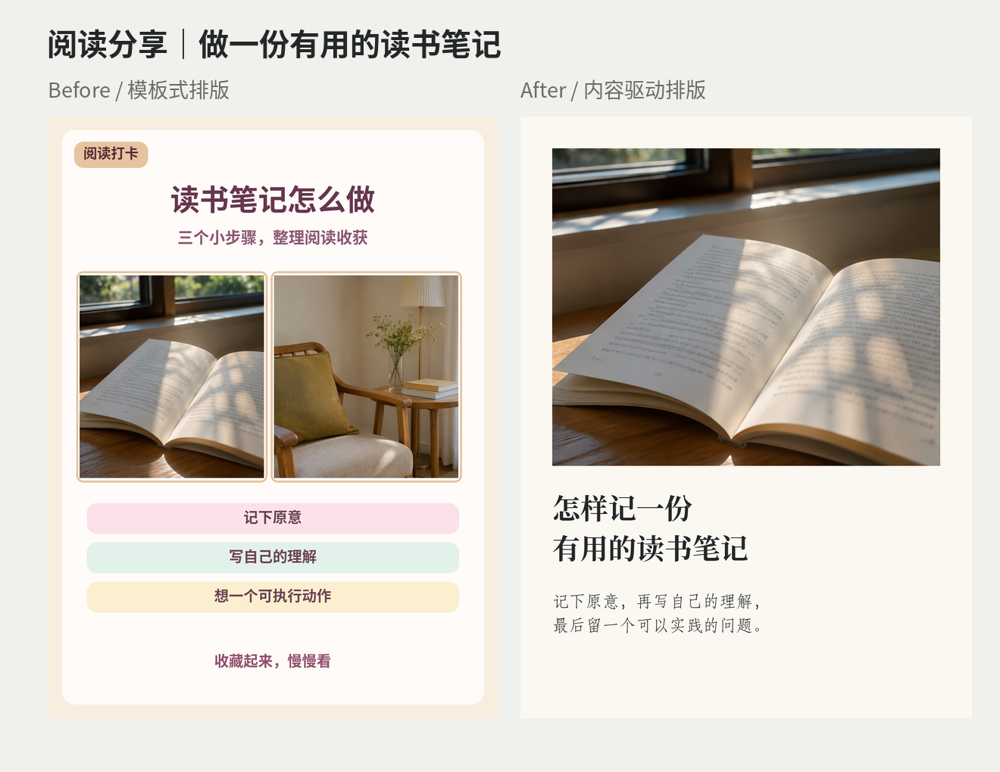
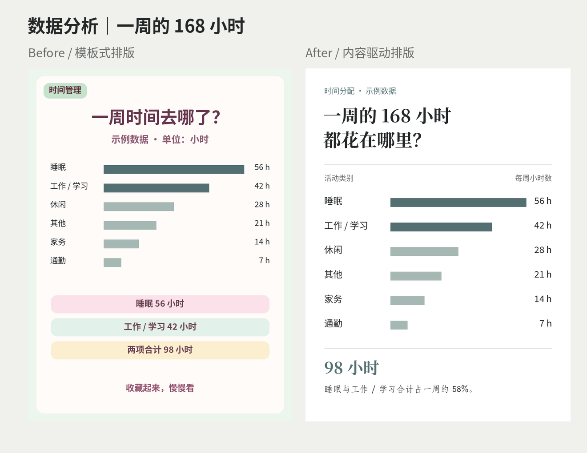
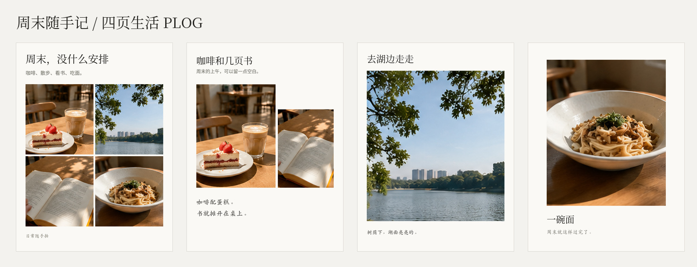

# XHS Creator Mode

让 AI 像真人博主一样发小红书。

Think like a creator. Design like a professional. Write like a human.

## 为什么做这个项目？

在使用 AI 制作小红书图文的过程中，我发现了一个重要问题：

“AI生图被平台识别，导致账号被限流，曝光度、转化度均较低的情况发生。”

AI生图有以下几个特点：
- 文案过于模板化，缺少真实的个人表达。
- 描述说明防御性过重，常见句式“虽然xxx，不代表xxx”。
- 图片像商业 PPT 或宣传海报。
- 过多的卡片、渐变、装饰和无意义标注。
- 真实操作截图被 AI 重绘，导致信息失真。
- 缺少专业的排版流程和最终审美检查。

因此，我将实际创作过程中不断迭代的经验整理成了这个 Agent Skill。

## 创作案例 / Showcase

从生活记录到知识科普，不同内容采用不同的表达方式。

[查看全部案例、素材说明及完整图文 →](examples/README.md)

| 生活记录｜周末随手记 | 旅行记录｜周末去看海 |
| --- | --- |
| [](examples/plog/README.md) | [](examples/travel-diary/README.md) |

| 好物分享｜桌面常用物 | 知识科普｜秋叶为什么变黄 |
| --- | --- |
| [](examples/product-sharing/README.md) | [](examples/science-explainer/README.md) |

| 行业观点｜AI改变哪些工作环节 | 软件教程｜用 Markdown 写笔记 |
| --- | --- |
| [](examples/opinion/README.md) | [](examples/software-tutorial/README.md) |

| 阅读分享｜做一份有用的读书笔记 | 数据分析｜一周的 168 小时 |
| --- | --- |
| [](examples/reading-notes/README.md) | [](examples/data-storytelling/README.md) |

> 案例用于展示排版和表达差异。AI 演示照片、合成数据、实际渲染页面等来源见各案例说明。


## 核心能力

- 创作者思维：梳理内容主题、叙事顺序和信息价值。
- 自然表达：减少套话、防御性表达及冗余说明。
- 原生设计：以文字、真实截图和简洁排版为主。
- 真实素材：保留原始截图、数据及实际经历。
- 隐私保护：对个人、账号和店铺信息进行遮盖。
- 专业审查：逐页检查信息、排版、标注和审美。
- 本地渲染：支持使用 Python 合成高清图文。

## 效果展示 · Before & After

同一组生活素材，两种不同的创作思路。


### 生活记录 PLOG



[查看完整创作案例](examples/plog/README.md)

## 适用场景

当前版本重点支持：

- 小红书实操经验分享
- 跨境电商运营教程
- 软件操作指南
- 科研实操教程
- 多页 SOP 图文
- 已有图文的重新设计

## 工作流程

真实素材整理
→ 内容与叙事规划
→ 确定视觉方向
→ 文案编写
→ 图片排版
→ 隐私及事实检查
→ 二次审美审查
→ 高清图片交付

## 安装方法

### Codex

在终端执行：

```bash
git clone https://github.com/TangRongkai/xhs-creator-mode.git
mkdir -p ~/.agents/skills
cp -R xhs-creator-mode/xhs-creator-mode ~/.agents/skills/
```

重新开启 Codex 会话。

## 使用方法

在 Codex 中输入：

```text
$xhs-creator-mode

根据我提供的真实素材，制作一套适合发布
到小红书的图文笔记。
```

也可以用于修改已有图文：

```text
$xhs-creator-mode

重新设计这套图片，减少模板化设计和
AI 式表达，保留真实截图和有效信息，
完成后逐页检查。
```

## 默认设计规范

- 图片比例：9:16
- 默认尺寸：1080 × 1920
- 字体：优先使用仿宋_GB2312
- 配色：白底、深色文字、少量红色强调
- 排版：文字为主，真实素材为辅
- 输出：高清 PNG、图片总览及 ZIP 压缩包

具体设计可以根据用户需求调整。

## 本地渲染环境

可选渲染脚本需要 Python 3.10+ 和 Pillow 10+。

字体使用本地合法授权的字体文件。

## 项目规划

- [x] 实操 SOP 图文工作流
- [x] 自然文案规范
- [x] 专业平面设计规范
- [x] 真实截图及隐私处理规范
- [x] 本地图片渲染脚本
- [ ] 公开创作案例及效果展示
- [ ] 更多小红书内容类型
- [ ] 自动化质量评估
- [ ] 更多 Agent 的兼容性测试

## License

MIT License

欢迎通过 Issue 提交建议及创作反馈。
  
