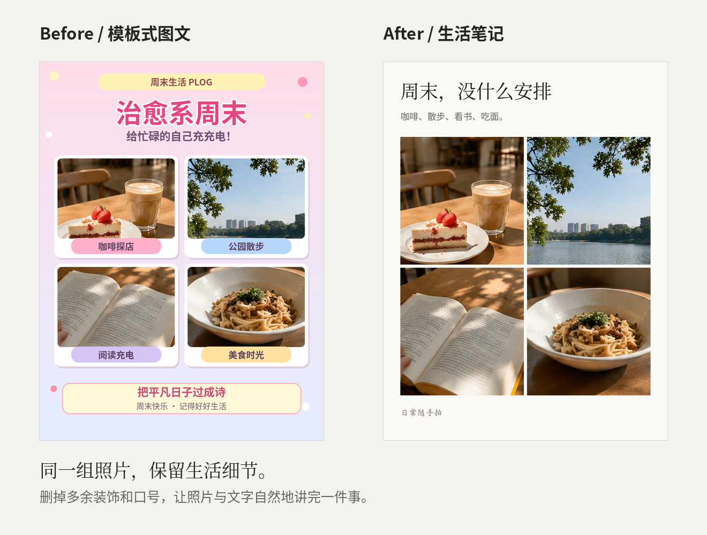
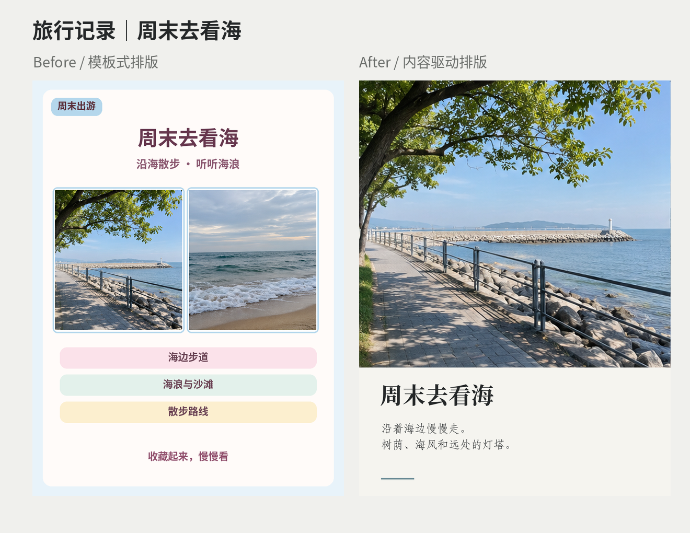
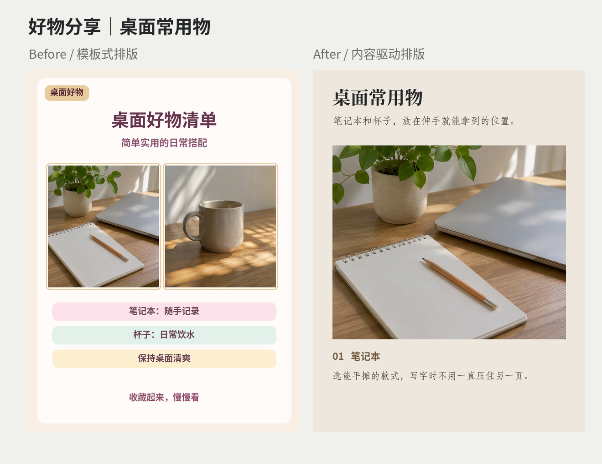
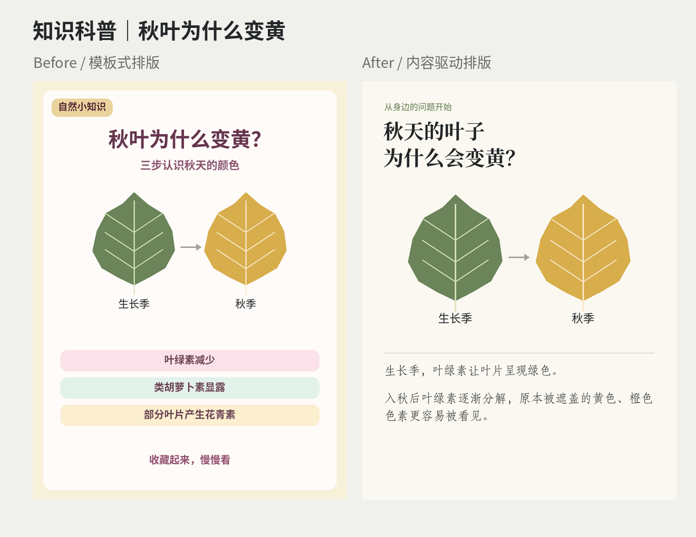
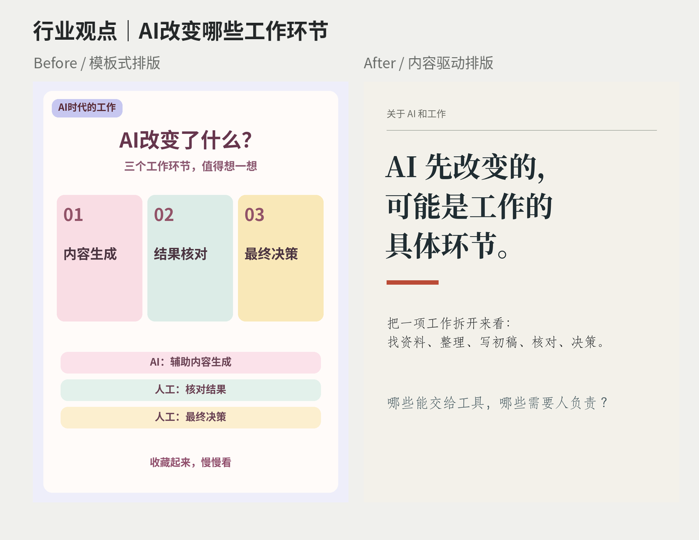
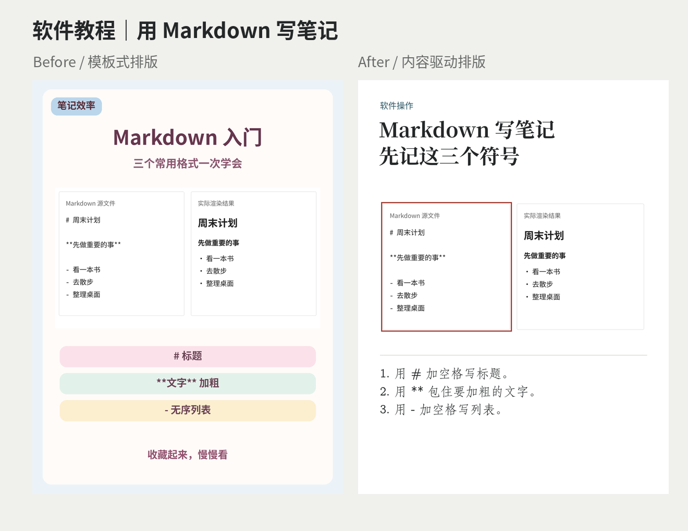
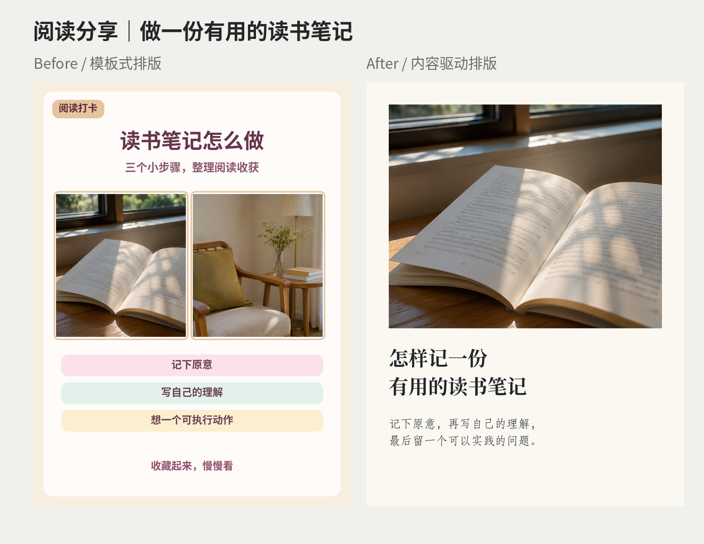
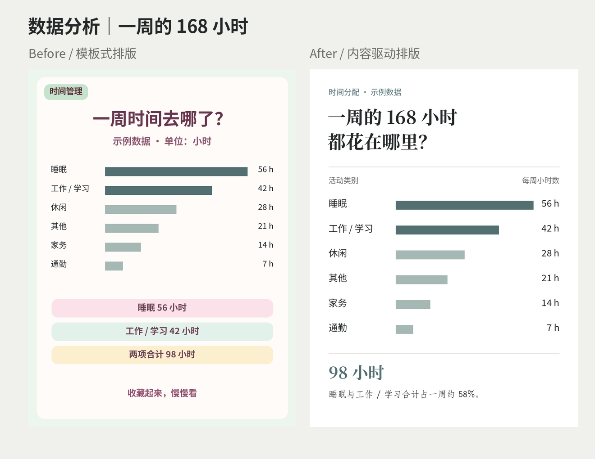

# 小红书创作案例 / Showcase

不同内容选择不同版式。以下案例展示设计决策，素材与事实来源见各案例 README。示例为策划和排版演示，尚未验证为 Skill 自动执行结果。

## 生活记录｜周末随手记

生活照片与自然叙事。

[完整示例](plog/overview.jpg) · [案例及素材说明](plog/README.md)

## 旅行记录｜周末去看海

用一组海边照片展示旅行记录的封面与内容节奏。

[完整示例](travel-diary/overview.jpg) · [案例及素材说明](travel-diary/README.md)

## 好物分享｜桌面常用物

以笔记本和杯子为例，展示具体使用场景与选购维度。

[完整示例](product-sharing/overview.jpg) · [案例及素材说明](product-sharing/README.md)

## 知识科普｜秋叶为什么变黄

从一个日常观察切入，解释叶片色素变化。

[完整示例](science-explainer/overview.jpg) · [案例及素材说明](science-explainer/README.md)

## 行业观点｜AI改变哪些工作环节

以一段示例观点展示文字型笔记和论证结构。

[完整示例](opinion/overview.jpg) · [案例及素材说明](opinion/README.md)

## 软件教程｜用 Markdown 写笔记

用实际渲染的本地 Markdown 示例说明基础语法。

[完整示例](software-tutorial/overview.jpg) · [案例及素材说明](software-tutorial/README.md)

## 阅读分享｜做一份有用的读书笔记

用自拟阅读方法示例展示笔记式表达。

[完整示例](reading-notes/overview.jpg) · [案例及素材说明](reading-notes/README.md)

## 数据分析｜一周的 168 小时

用一份虚构但内部一致的时间分配数据示例演示图表表达。

[完整示例](data-storytelling/overview.jpg) · [案例及素材说明](data-storytelling/README.md)
