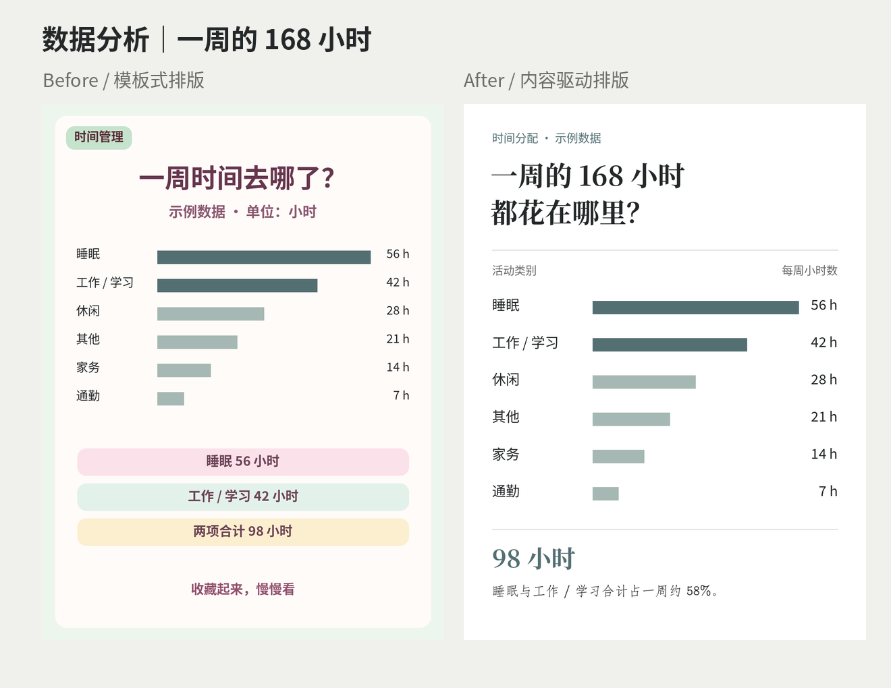
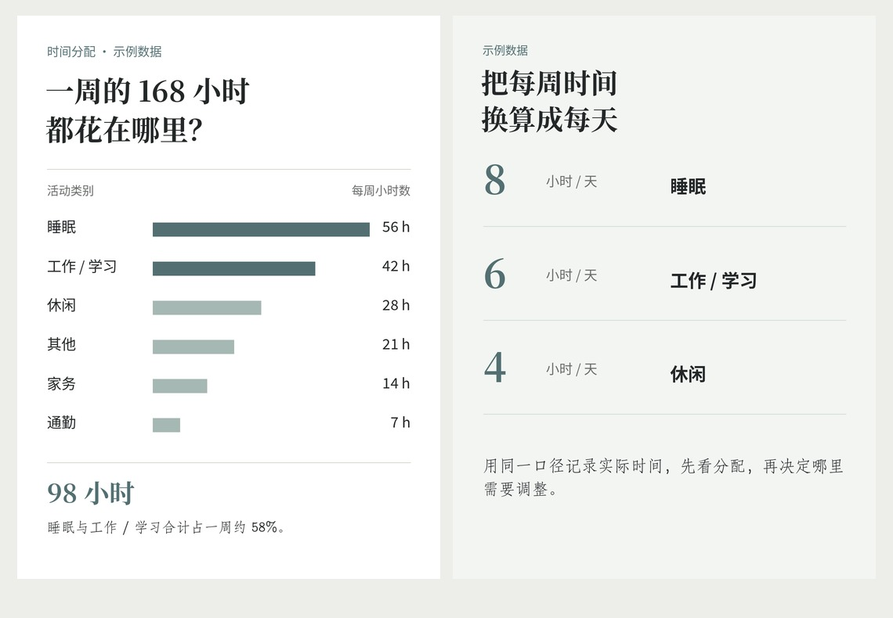

# 数据分析｜一周的 168 小时

用一份虚构但内部一致的时间分配数据示例演示图表表达。

## Before / After

Before 同样的数据带着额外的标签和色块；After 用对齐的横向条形图明确数量和单位，再从数据本身提炼观察。

## 两页示例

[第 1 页](pages/01_cover.png) · [第 2 页](pages/02_detail.png)

## 素材来源与示例性质

`assets/time-budget.csv` 为手工构造的示例数据，不是作者或其他人的实测记录。六类活动合计 168 小时；图表直接由数据绘制，无推断真实人群行为。

本例为人工策划、程序排版的设计演示（非自动调用 Skill 的实测结果），不代表平台流量、互动效果或 AI 检测表现。

Demo of editorial layout choices; not a benchmark or an account of the author's personal experience.
