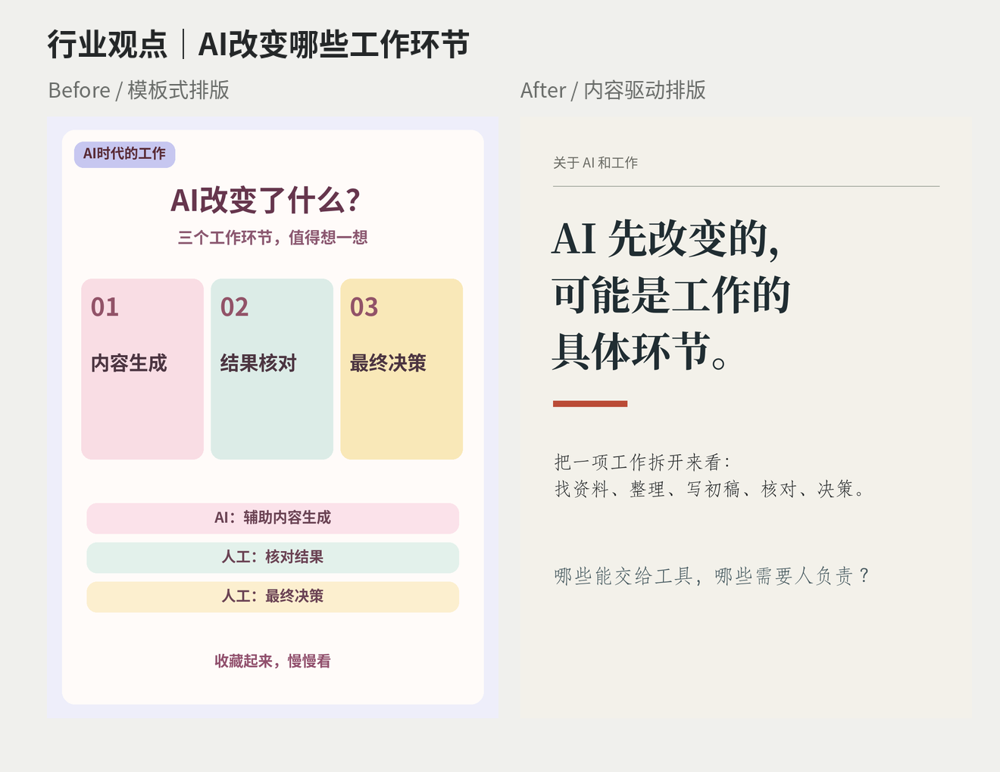
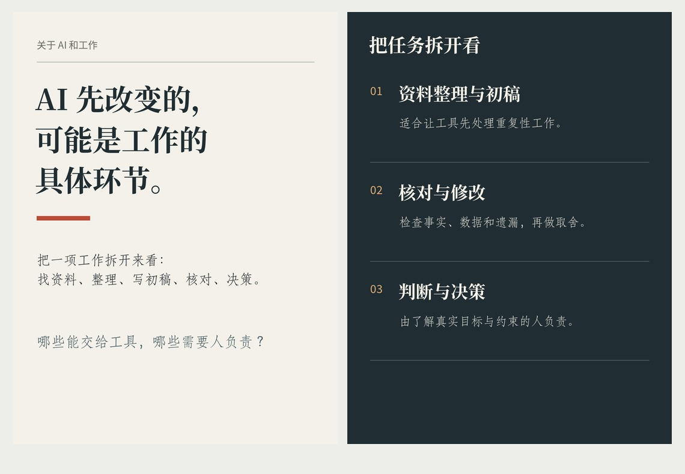

# 行业观点｜AI改变哪些工作环节

以一段示例观点展示文字型笔记和论证结构。

## Before / After

Before 是常见口号加三张卡片的结构；After 让主张占据封面，下一页用具体工作环节解释观点，减少结论式套话。

## 两页示例

[第 1 页](pages/01_cover.png) · [第 2 页](pages/02_detail.png)

## 素材来源与示例性质

原创示例观点，不是作者亲身经历、调查结果或就业预测。例子说明一种人机协作思路，不主张所有行业都存在相同变化。

本例为人工策划、程序排版的设计演示（非自动调用 Skill 的实测结果），不代表平台流量、互动效果或 AI 检测表现。

Demo of editorial layout choices; not a benchmark or an account of the author's personal experience.
