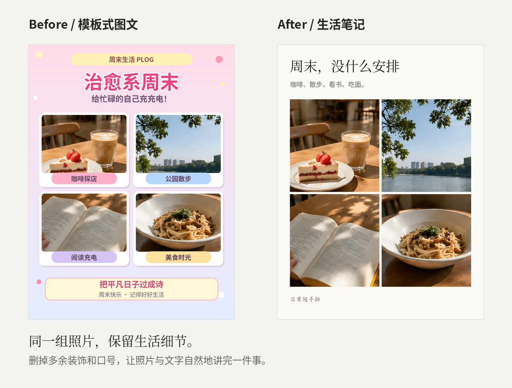
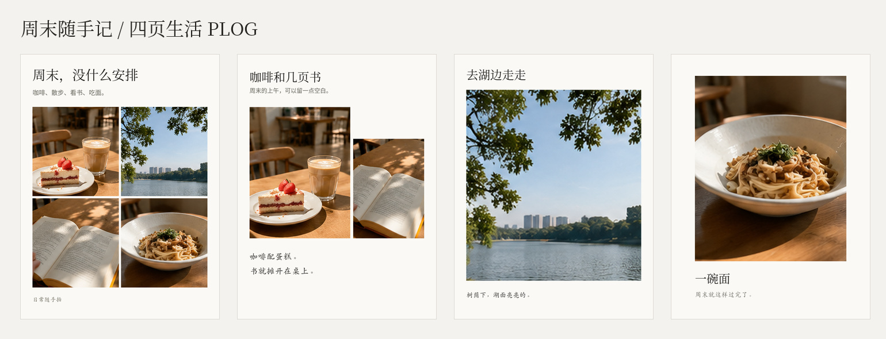

# 周末随手记 · Weekend PLOG

用于 `xhs-creator-mode` 项目的设计演示。主题为周末生活记录：咖啡、读书、湖边散步和晚餐。

## Before / After

| Before | After |
|---|---|
| 多种色块、装饰、口号及标签 | 简短标题、留白、自然阅读节奏 |
| 照片被装饰性信息压缩 | 保留照片主体和清晰的画面层级 |

## 四页示例

- `pages/01_cover.png`：封面，四张照片概括主题。
- `pages/02_coffee_and_book.png`：咖啡和阅读。
- `pages/03_lakeside.png`：湖边散步。
- `pages/04_dinner.png`：晚餐收尾。
