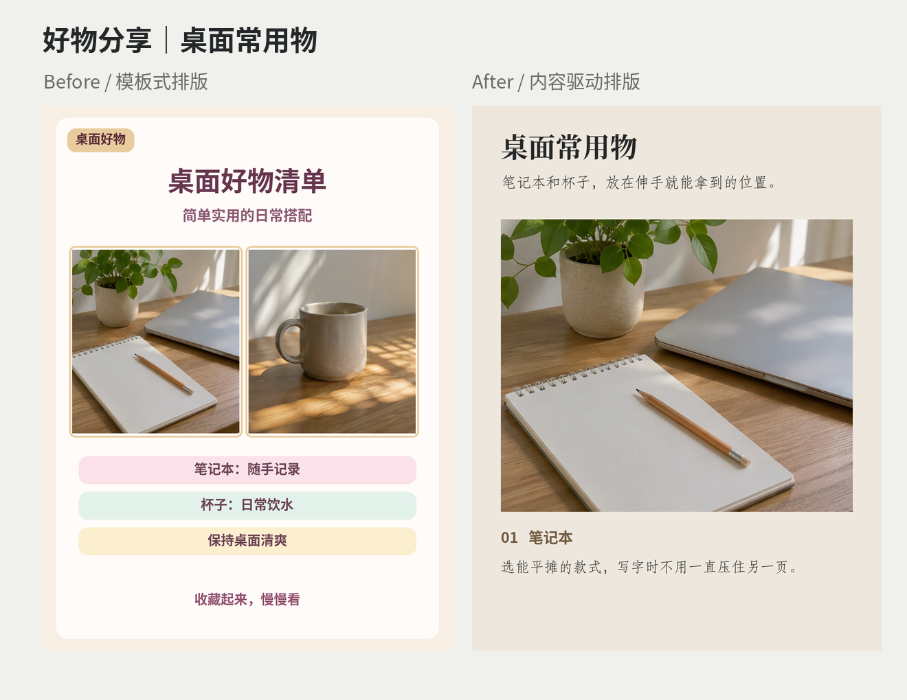
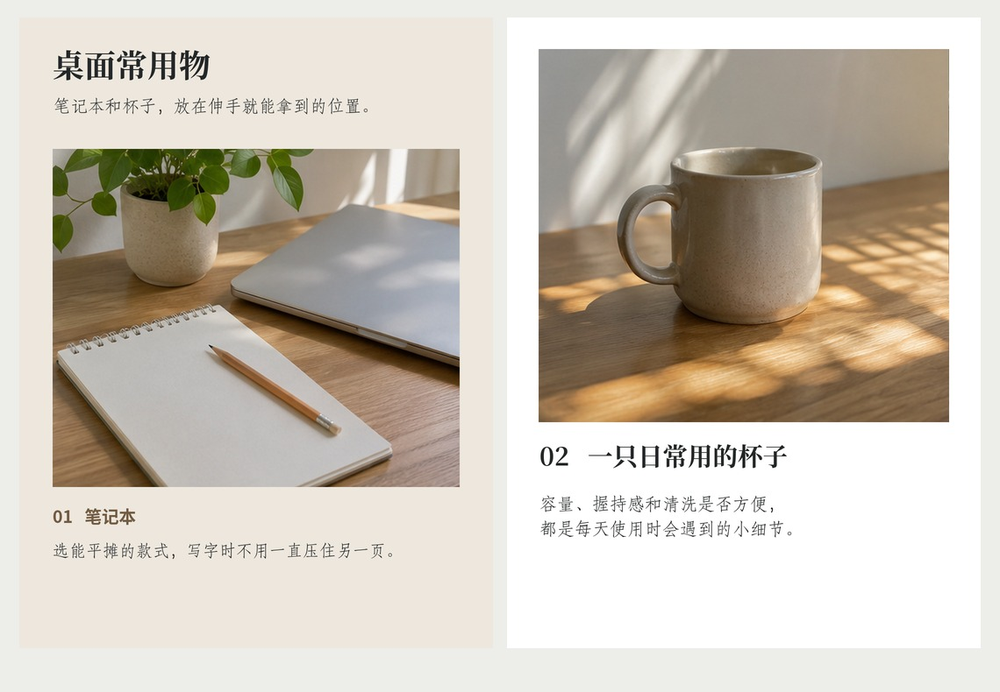

# 好物分享｜桌面常用物

以笔记本和杯子为例，展示具体使用场景与选购维度。

## Before / After

Before 用标签制造“种草清单”的视觉节奏；After 直接呈现物品与使用场景，不使用性能、销量或亲测时长等无依据宣称。

## 两页示例

[第 1 页](pages/01_cover.png) · [第 2 页](pages/02_detail.png)

## 素材来源与示例性质

照片为 AI 生成的无品牌物品演示，非真实商品实拍或实际使用测评。文案只提供一般选购观察；不包含价格、品牌及购买链接。

本例为人工策划、程序排版的设计演示（非自动调用 Skill 的实测结果），不代表平台流量、互动效果或 AI 检测表现。

Demo of editorial layout choices; not a benchmark or an account of the author's personal experience.
