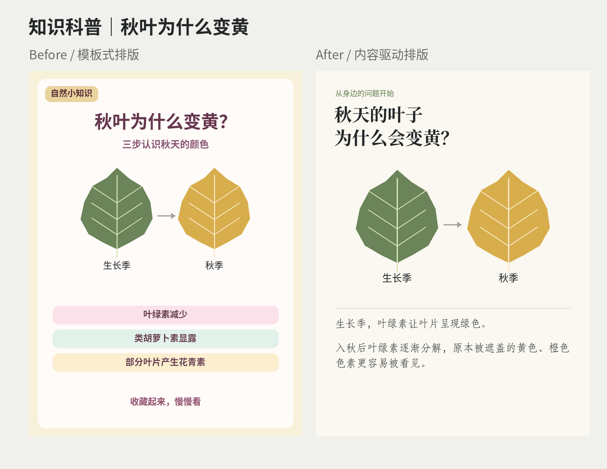
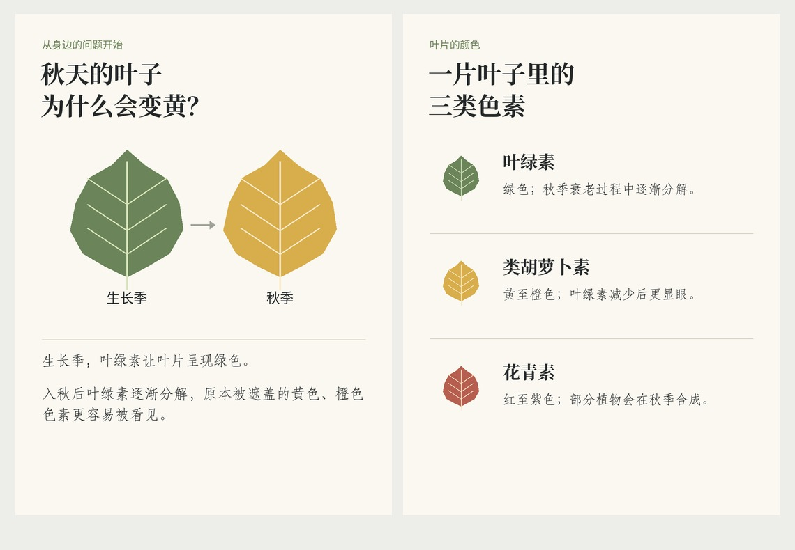

# 知识科普｜秋叶为什么变黄

从一个日常观察切入，解释叶片色素变化。

## Before / After

Before 以知识标签呈现概念；After 把“叶绿素减少 → 黄色色素显露”的因果关系变成可视化图示，第二页补充不同颜色的机制。

## 两页示例

[第 1 页](pages/01_cover.png) · [第 2 页](pages/02_detail.png)

## 素材来源与示例性质

叶片是程序绘制的概念示意（不是显微图、实验结果或定量比例）。资料：NOAA, [Cool autumn weather reveals nature’s true hues](https://www.noaa.gov/stories/cool-autumn-weather-reveals-natures-true-hues)；Archetti et al. (2009), Trends in Ecology & Evolution, DOI: [10.1016/j.tree.2008.10.006](https://doi.org/10.1016/j.tree.2008.10.006)；[Kew: Why do leaves change colour in autumn?](https://www.kew.org/read-and-watch/why-do-leaves-change-colour)。

本例为人工策划、程序排版的设计演示（非自动调用 Skill 的实测结果），不代表平台流量、互动效果或 AI 检测表现。

Demo of editorial layout choices; not a benchmark or an account of the author's personal experience.
