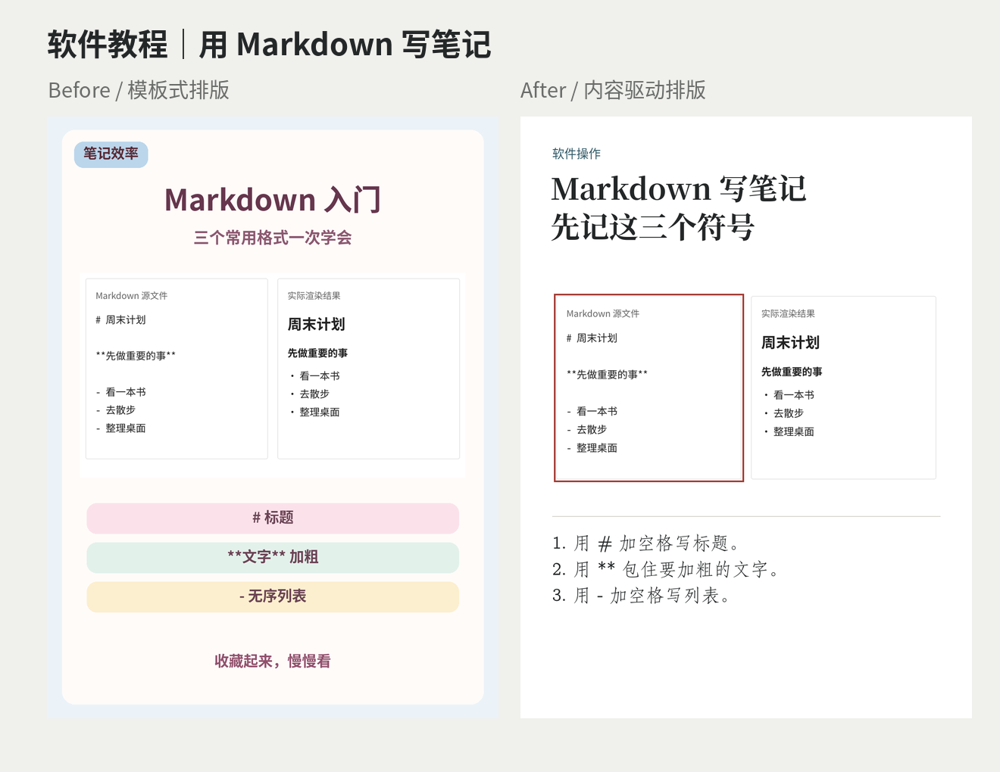
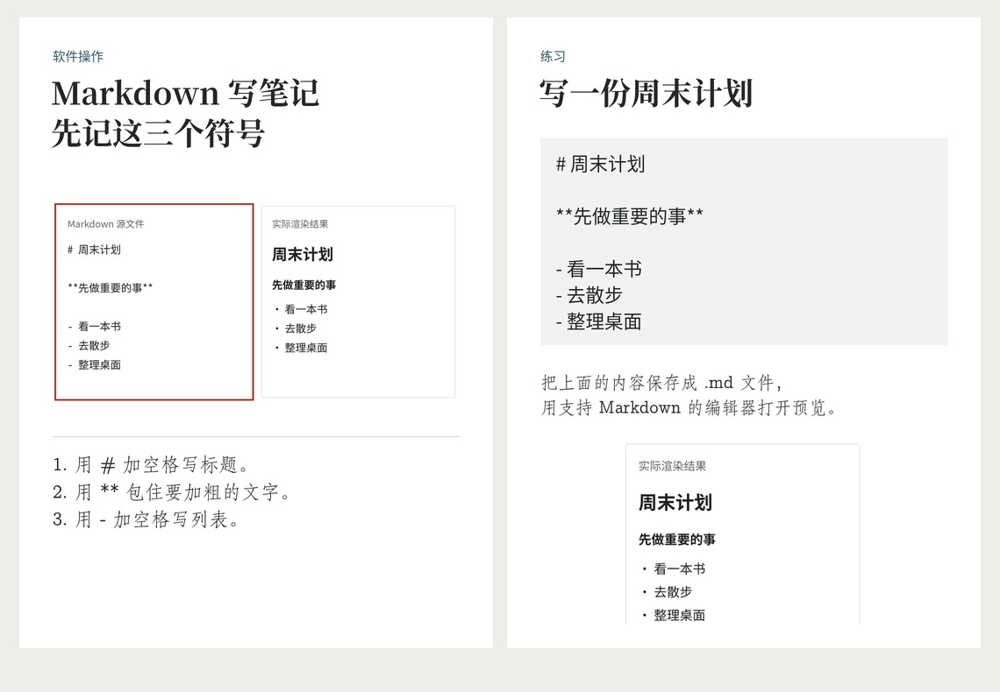

# 软件教程｜用 Markdown 写笔记

用实际渲染的本地 Markdown 示例说明基础语法。

## Before / After

Before 将真实画面压进装饰卡片；After 放大源码和实际渲染结果，通过精确标注、自然步骤告诉读者如何操作。

## 两页示例

[第 1 页](pages/01_cover.png) · [第 2 页](pages/02_detail.png)

## 素材来源与示例性质

`assets/source.md` 是原创 Markdown 文本；`assets/preview.html` 为 Mistune 渲染 HTML，`assets/markdown-preview.png` 是 WeasyPrint 实际渲染页面的栅格化裁切版本。没有模仿第三方软件或虚构后台。语法参考：[CommonMark reference](https://commonmark.org/help/)。

本例为人工策划、程序排版的设计演示（非自动调用 Skill 的实测结果），不代表平台流量、互动效果或 AI 检测表现。

Demo of editorial layout choices; not a benchmark or an account of the author's personal experience.
