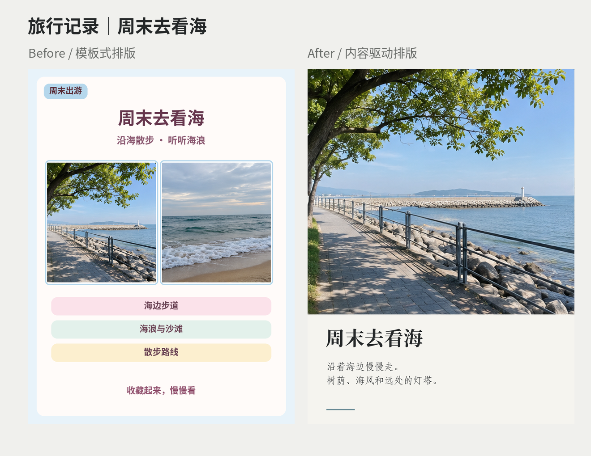
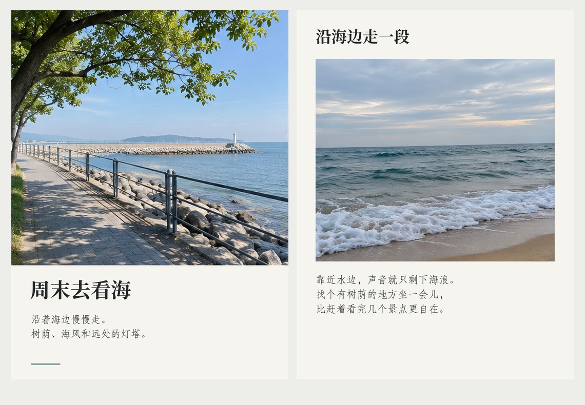

# 旅行记录｜周末去看海

用一组海边照片展示旅行记录的封面与内容节奏。

## Before / After

Before 将照片装进统一卡片，文字以标签组织；After 用大图建立空间感，第二页用照片与简短观察推进叙事。

## 两页示例

[第 1 页](pages/01_cover.png) · [第 2 页](pages/02_detail.png)

## 素材来源与示例性质

照片为本次 AI 生成的演示素材（`assets/` 中的两张裁切图），没有指向真实地点或作者亲历。文案是情境示例。

本例为人工策划、程序排版的设计演示（非自动调用 Skill 的实测结果），不代表平台流量、互动效果或 AI 检测表现。

Demo of editorial layout choices; not a benchmark or an account of the author's personal experience.
